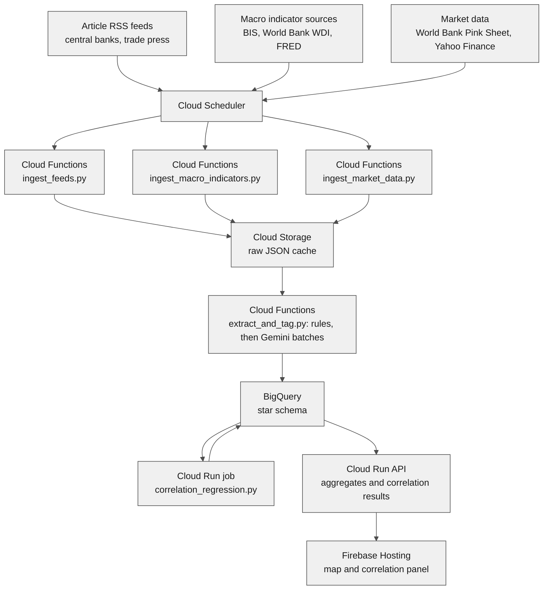
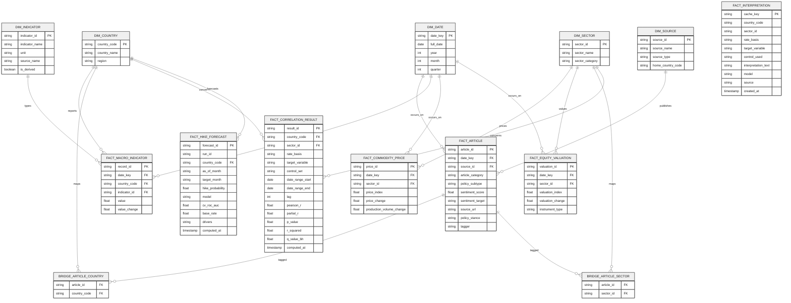
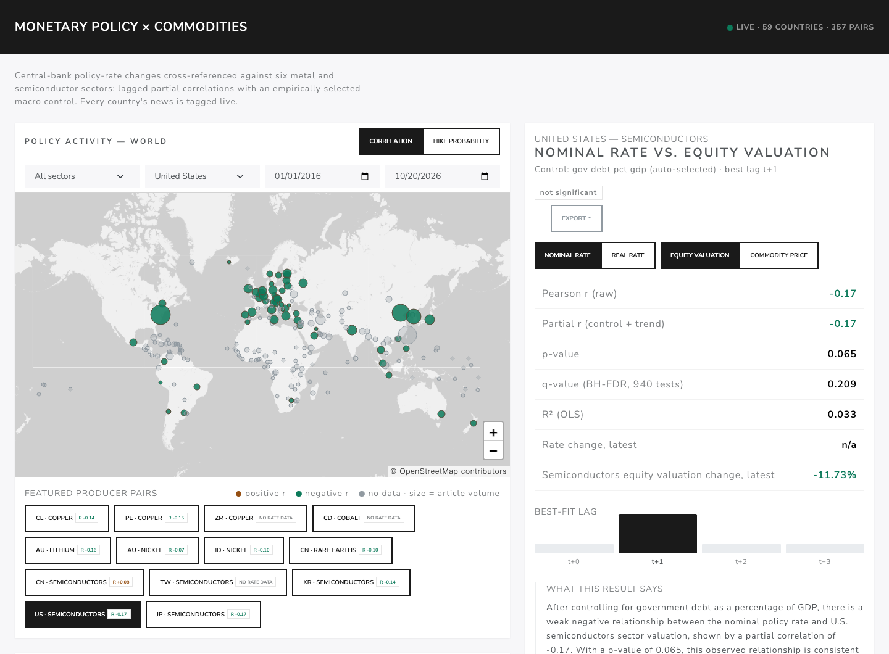
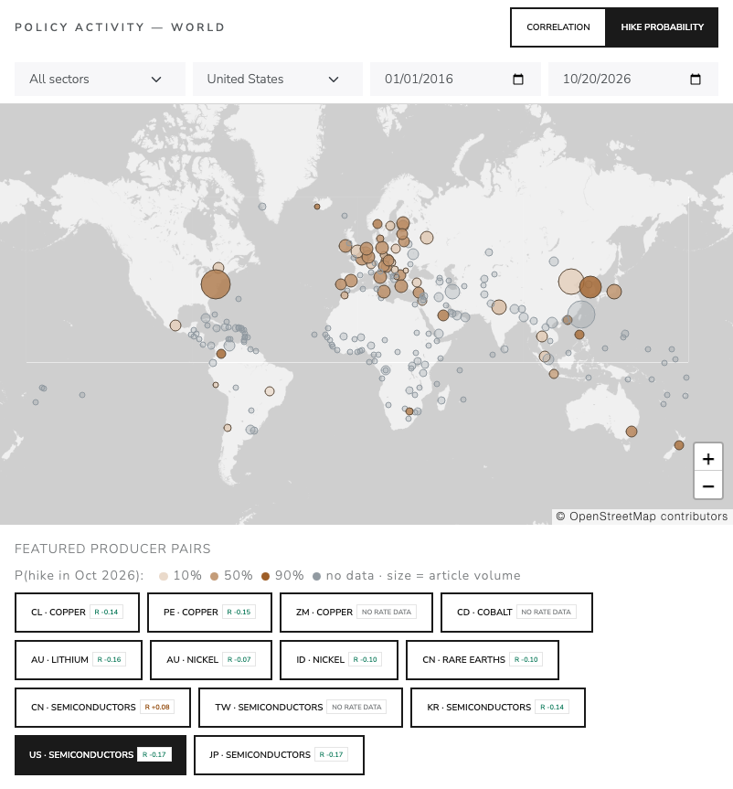
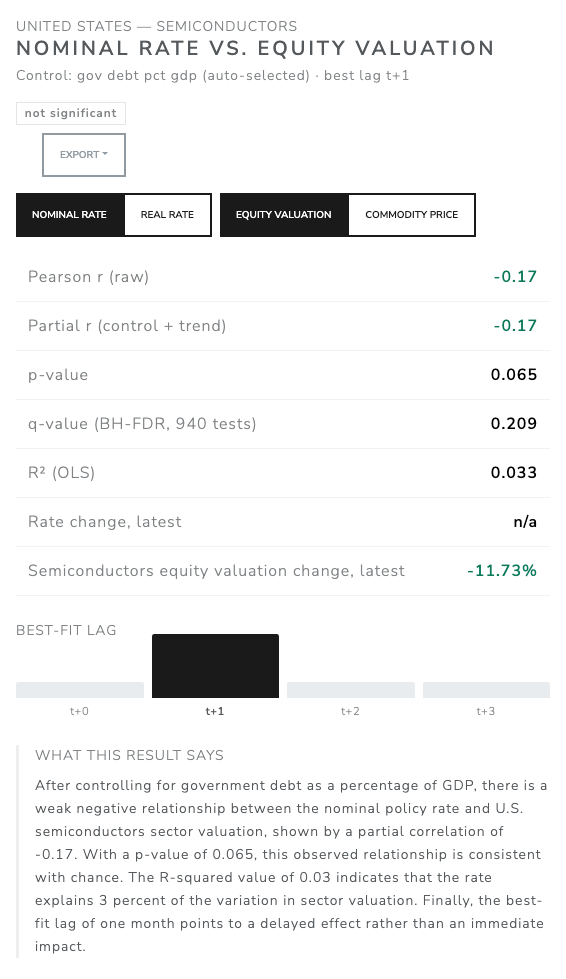
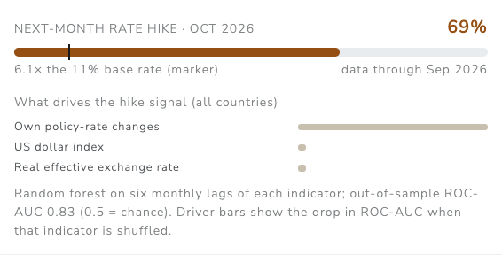
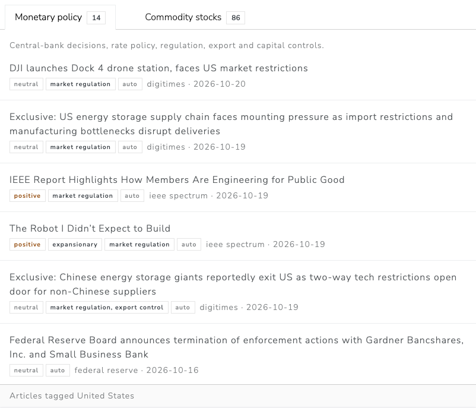
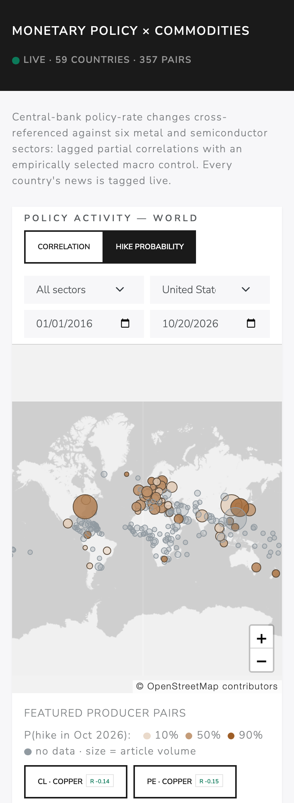

# mp-commodities-corr: Monetary Policy × Metal & Semiconductor Commodity Correlation Tracker

**Live:** [mp-commodities-corr.web.app](https://mp-commodities-corr.web.app)

A serverless GCP application that (i) ingests and tags monetary-policy and commodity news for every economy, and (ii) estimates lagged partial correlations and OLS fits between policy-rate changes (nominal and real) and sector valuations. Controls are selected empirically per pair. Tagging is rules-first, with batched LLM refinement. The system runs entirely within GCP's Always Free tier.

| Scope | Value |
| --- | --- |
| Sectors | copper, lithium, nickel, rare earths, cobalt, semiconductors (industrial/supply-chain; precious metals excluded as safe-haven assets with different transmission) |
| Countries | 218 economies (World Bank list + Taiwan) for news and macro controls; 59 with a BIS policy-rate series (38 BIS areas + 21 euro members) |
| Country/sector pairs | 1,308 (all × all); 351 with estimable results; 13 featured producer pairs (e.g. CL/copper, CD/cobalt, TW/semiconductors) |
| Candidate controls | 7 (FDI, CPI, GDP growth, unemployment, trade balance, REER, gov. debt % GDP) |
| Lag sweep | t, t+1, t+2, t+3 (monthly) |
| Active RSS feeds | 11 verified (central banks, commodity and semiconductor trade press) |
| Specifications per batch | 1,308 pairs × 2 rate bases × 2 targets → 940 estimable results (production) |

---

## Stack

| Layer | Tools |
| --- | --- |
| Ingestion | `feedparser`, BIS / World Bank WDI / FRED / Pink Sheet APIs, `yfinance`; Cloud Functions + Cloud Scheduler |
| NLP tagging | Deterministic dictionary tagger (`etl/rule_tagger.py`) for every article; Gemini batch refinement (20 articles/call, `response_schema`-constrained JSON, temperature 0.1, `flash` → `flash-lite` fallback) |
| Statistics | Two engines via `STATS_ENGINE`: NumPy/SciPy closed-form kernels (default) or Pingouin (reference); identical to 3.1e-15 across 928 local results |
| ML (notebooks) | scikit-learn: ridge, lasso, elastic net, SVR/SVC, k-NN, random forest, histogram gradient boosting, MLP, logistic regression, Gaussian naive Bayes |
| Distributed (opt-in) | Apache Spark 3.5 (`groupBy().applyInPandas`) |
| Storage | BigQuery star schema (prod) / DuckDB, same DDL and SQL (dev); GCS raw cache, 30-day lifecycle |
| Serving | FastAPI on Cloud Run (main + separate export service: CSV/XLSX/PDF via `openpyxl`, `reportlab`) |
| Frontend | Bootstrap 5.3 + Bootswatch Lux, Leaflet world map (all 218 economies; correlation or hike-probability layer), Firebase Hosting |
| IaC / CI | Terraform, Cloud Build, GitHub Actions |

---

## Architecture



| Job | Trigger | Output |
| --- | --- | --- |
| `etl/ingest_feeds.py` | Scheduler, 3×/day | SHA-256(URL)-deduplicated raw JSON → GCS |
| `etl/extract_and_tag.py` | GCS object-finalize | Pass 1: every article rule-tagged and written (`tagger='rules'`). Pass 2: queued articles refined newest-first by Gemini, 20 per call, ≤15 calls/day, overwriting with `tagger='llm'` |
| `etl/ingest_macro_indicators.py` | (bundled below) | 11 bulk requests cover all countries: BIS ×2, WDI ×6, FRED ×3 (daily series fetched as monthly averages) |
| `etl/ingest_macro_indicators.py` + `ingest_market_data.py` | Scheduler, monthly (one combined function, which keeps the job count within the 3-job free tier) | `fact_macro_indicator`, `fact_commodity_price`, `fact_equity_valuation` |
| `analysis/correlation_regression.py` → `analysis/forecast.py` | Scheduler, monthly (one Cloud Run job, 2 vCPU / 2 GiB) | Append-only `fact_correlation_result` with BH *q*-values, then `fact_hike_forecast` (per-country next-month hike probability) |

**Feed reliability.** Production stored 0 articles from launch to 2026-10-19, with 5,350 queued. Three causes:
- Every Gemini call failed with `503 UNAVAILABLE` (free-tier overload), and failed attempts still consumed the 15-call daily budget.
- Extraction made one call per article, while ingest fetches ~445 a day.
- RFC-822 `published` strings ("Thu, 16 Jul 2026 …") were invalid for the `TIMESTAMP` column, and `date_key = published[:10]` produced "Thu, 16 Ju".

The fix: rules-first tagging so no article waits on quota, 20-article batches with model fallback, and ISO-8601 normalization at ingest and write. On 20 LLM-refined articles the rules agree on 100% of categories, 100% of country overlaps and 90% of sector sets.

**Coverage gaps (logged and skipped, never imputed):** Pink Sheet has spot prices only for copper and nickel among the six sectors. 159 economies (including TW, ZM, CD) have no BIS policy-rate series; they get macro controls and news tagging but no rate correlation. The euro-area ECB rate (BIS `XM`) is spliced onto each member from its adoption month, after its national central bank's series. Two feed categories (`world_bank_group`, `mnc_bank`) have no working public RSS and are marked `needs_research` in `etl/feeds.yaml`. `etl/mock_rss_server.py` simulates them for local volume testing.

---

## Data Model

Long-format `fact_macro_indicator` typed by `dim_indicator` means adding a control is a row insert plus a source adapter, with no schema migration. Multi-valued article→country/sector tags use bridge tables. `real_interest_rate` is derived (`policy_rate − cpi_inflation`). WDI annual series are forward-filled to monthly and flagged `is_interpolated`.



`fact_correlation_result` is append-only (`computed_at`), so estimates form a time series and exports are reproducible snapshots; `q_value_bh` is the Benjamini–Hochberg *q* within the run that produced the row. `fact_hike_forecast` stores one row per country per monthly run, repeating run-level quality metrics (walk-forward ROC-AUC, base rate, JSON drivers). `fact_interpretation` caches LLM output keyed by SHA-256 of all inputs.

---

## Methodology

### Specification

For pair *(c, s)*, rate basis *b* ∈ {nominal, real}, target *y* ∈ {equity valuation Δ, commodity price Δ} and lag *ℓ* ∈ {0..3}:

- **Baseline:** Pearson *r*(Δrate*ₜ*, Δy*ₜ₊ℓ*).
- **Control selection:** for each candidate *z*, the first-order partial correlation *r*<sub>xy·z</sub> = (*r*<sub>xy</sub> − *r*<sub>xz</sub>*r*<sub>yz</sub>) / √((1−*r*<sub>xz</sub>²)(1−*r*<sub>yz</sub>²)) is computed in O(*n*). The argmax |*r*<sub>xy·z</sub>| wins (ties → lower *p*). Zero-variance controls (undefined *r*<sub>xy·z</sub>) are excluded.
- **Reported partial *r*:** conditioned on {*z*\*, linear time trend}, from the precision matrix *P* = Σ⁺: *r* = −*P*<sub>xy</sub> / √(*P*<sub>xx</sub>*P*<sub>yy</sub>).
- **Fit:** OLS Δy ~ 1 + Δrate + *z*\*, reporting *R*².
- **Inference:** two-sided *t*-test, *t* = *r*√(dof / (1−*r*²)), dof = *n* − *k* − 2.
- **Lag selection:** the ℓ maximizing |Pearson *r*|, with `MIN_OBS = 8`.

`/api/correlation` runs the same `run_one()` synchronously on any date window (≤ a few hundred rows). The optional `control` parameter pins *z*.

```mermaid
%%{init: {'theme': 'base', 'themeVariables': { 'primaryColor': '#f0f0f0', 'primaryBorderColor': '#4d4d4d', 'primaryTextColor': '#1a1a1a', 'lineColor': '#4d4d4d', 'secondaryColor': '#e0e0e0', 'tertiaryColor': '#ffffff' }}}%%
flowchart LR
    A["BigQuery<br/>macro + commodity price + equity valuation"]
    B["Bulk fetch (3 queries)<br/>pivot + join on date_key"]
    C["Control selection<br/>argmax |partial r| over 7 candidates"]
    D["Partial r (precision matrix)<br/>OLS R², t-test p"]
    E["Lag sweep<br/>t, t+1, t+2, t+3"]
    F["Best-fit result<br/>per pair / basis / target"]
    G["Append to<br/>fact_correlation_result"]

    A --> B --> C --> D --> E --> F --> G
```



### Identification notes

- **Nominal vs. real rate** are separate regressors. Schischke & Rathgeber (2025) document a sign reversal in the rate–commodity response between the pre-2008 and ZLB regimes. In a ZLB regime the nominal rate is near-constant while the real rate varies. Date-window filtering supports split-sample (pre/post-2008) tests directly.
- **Transmission channels** are tagged per article by the extractor (`mechanisms`). Each has a proxy regressor: cost of carry → `real_interest_rate`; USD channel → `usd_index`; portfolio substitution → `treasury_yield_10y`; extraction incentives → `production_volume_change` (metals only, currently NULL pending USGS ingest).
- **Caveats:** associations are not causal. The control/lag search over 7 × 4 specifications is a specification search, and *R*² values are in-sample. FRED global series (`country_code IS NULL`) do not enter country panels.
- **Multiplicity:** of 940 specifications (production batch), 245 (26.1%) have *p* < 0.05 against ~5% expected under the null. 54 survive Benjamini–Hochberg FDR at 5%, and 11 survive Bonferroni. Each result stores its q-value, and the panel badge reports FDR-robustness (`notebooks/02`, `pg.multicomp`). Most BH survivors are *real rate → nickel price at t+2* across euro members, which share one ECB rate, so they are not independent findings.

### Representative results (local warehouse, current batch)

| Pair | Basis → target | Control | Lag | *r* | partial *r* | *p* | *R*² |
| --- | --- | --- | --- | --- | --- | --- | --- |
| PE/copper | real → equity | REER | t+1 | −0.249 | −0.254 | 0.006 | 0.063 |
| PE/copper | nominal → commodity | gov. debt | t+3 | −0.167 | −0.194 | 0.008 | 0.099 |
| CL/copper | real → equity | GDP growth | t+1 | −0.206 | −0.235 | 0.025 | 0.076 |
| JP/semis | real → equity | GDP growth | t+3 | 0.226 | 0.235 | 0.015 | 0.056 |
| AU/lithium | nominal → equity | gov. debt | t+3 | −0.181 | −0.186 | 0.049 | 0.079 |

Effect sizes are weak (|*r*| < 0.26). For AU/lithium, empirical control selection raises in-sample *R*² from 0.040 (FDI fixed) to 0.079.

### LLM layer

- **Rule tagger (all articles):** dictionary classifier (Loughran & McDonald, 2011; Apel & Blix Grimaldi, 2014). Countries are matched case-sensitively, longest first, over 218 names plus central banks, capitals and sector companies, with exclusion sentinels ("Latin America", "Bank of America"). Sector lexicons are atomized per commodity. Stance is hawkish − dovish term count; sentiment is (pos − neg)/(pos + neg). It tags 445 articles in ~0.4 s. Its main precision limit is generic policy vocabulary: tech-trade headlines mentioning "restrictions" can be tagged *market regulation*. LLM refinement corrects these, and the UI marks each article `auto` or `LLM`.
- **LLM extraction (refinement):** category-first multi-label classification. `article_category` ∈ {monetary_policy, commodity_stocks} gates which fields are populated: `policy_subtype` for policy articles, atomized `sector_tags` for commodity articles. Also extracted: `country_codes`, `sentiment_score` ∈ [−1, 1], `policy_stance` ∈ {contractionary, expansionary, neutral} and `mechanisms`. Free-tier prompts may be used by Google for training; inputs are public news.
- **Interpretation (`/api/interpret`):** Gemini paraphrases only the active result's statistics (direction, |partial *r*| band 0.3/0.5, *p* vs 0.05, *R*², lag). Responses are SHA-256-cached. On failure the endpoint returns `503` and the frontend falls back to a deterministic rule-based summary.

### ML models (`notebooks/03_ml_forecasting.ipynb`)

Pooled panel: 9,117 country-months, 39 countries (euro area counted once), 42 features (6 lags × 7 indicator changes including FRED globals), 2006-07 to 2026-08. Validation is 5-fold walk-forward; hyperparameters come from an inner 3-fold `TimeSeriesSplit` grid.

| Task | Best | Benchmark | Others |
| --- | --- | --- | --- |
| Δpolicy-rate magnitude (RMSE) | random forest 0.908 (−1.5%; Diebold–Mariano *p* = 0.03, but MAE 0.178 vs 0.148) | no-change 0.922 | k-NN −0.3%, SVR +0.1%, HistGBM +0.1%, lasso +0.3%, ridge +9.1%, MLP +12.1% |
| Next-month hike (ROC-AUC; base rate 11.4%) | random forest 0.833 (bal. acc. 0.777) | persistence 0.625 | HistGBM 0.819, RBF-SVC 0.695, logistic 0.679, k-NN 0.599, naive Bayes 0.550 |

**In production:** the hike classifier runs monthly (`analysis/forecast.py`, after the correlation batch). It uses the same random forest with publication-lag-aware features (REER enters one month later, matching its BIS release) and stores per-country probabilities, the run's walk-forward ROC-AUC, the base rate and permutation-importance drivers in `fact_hike_forecast`. The UI shows these as a map layer and a panel section. scikit-learn ships only in the analysis image.

Policy direction is forecastable; magnitude is not, beyond a marginal gain. Tree ensembles dominate because rate cycles are regime-like and non-linear. SVMs cost the most compute (O(n²)) for less accuracy, and k-NN and naive Bayes fail on correlated, non-stationary lags. The MLP overfits, and LSTMs are not identifiable at *n* ≈ 230 months per country. Reinforcement learning has no applicable action/reward formulation. VAR/SVAR and local projections are the recommended next step for causal identification. `notebooks/02` also holds `LassoCV` joint control selection (α by `TimeSeriesSplit`).

---

## Performance & Cost

| Change | Effect (1,308 pairs unless noted) |
| --- | --- |
| Pingouin → closed-form NumPy/SciPy kernels (Pingouin kept as `STATS_ENGINE=pingouin`) | Compute 63.5 s → 17.7 s (3.6×), identical to 3.1e-15. Zero-variance controls are now excluded under both engines; Pingouin's pseudo-inverse had returned the raw *r* for them, letting a constant "control" win selection |
| Per-pair queries → one bulk fetch, pivot per country | 3 warehouse queries per batch instead of 3 per pair; panel build 25.2 s → 1.9 s |
| Macro ingest: per-country → bulk all-country requests | ~120 → 11 HTTP requests; 504k rows across 216 countries in 6.6 s; vectorized annual→monthly expansion (`merge_asof`) |
| Article tagging: 1 LLM call/article → rules + 20-article batches | 15 → 300 LLM-refined articles/day within the same quota; 100% of articles tagged immediately |
| API TTL caches (`PANEL_CACHE_TTL_S`, 3600 s) on panels and `/api/pairs` | Repeat requests skip the warehouse (local: 71 ms → 20 ms) |
| `requirements-notebooks.txt` split | Pingouin, statsmodels, scikit-learn, matplotlib, seaborn and JupyterLab stay out of Cloud Run images and Cloud Function packages (Artifact Registry free tier: 0.5 GB) |
| Spark runner (`analysis/spark_job.py`, opt-in) | Identical results; 12.7 s on `local[*]` (8 cores) vs 18.4 s pandas. A 1-vCPU Cloud Run job gains nothing, so Spark pays off only on a multi-core cluster (Dataproc Serverless, which is billed) |

### Cost model: what is hardcoded, what is fitted, what runs where

| Layer | Approach | Why | GCP cost |
| --- | --- | --- | --- |
| Article tagging | Hardcoded lexicons (rules) first; LLM refines | Deterministic, auditable, zero marginal cost; the LLM adds nuance only where quota allows | Gemini free tier (≤15 calls/day); Cloud Functions free tier |
| Statistical inference | Closed-form estimators, no tuning; only lag (0–3) and one control selected empirically | Small monthly samples favour low-variance estimators; closed forms are exact and cheap | One monthly Cloud Run job (seconds of vCPU) |
| Forecasting / classification | Fitted models with time-series-CV hyperparameter search | Only where it measurably beats a benchmark (direction: AUC 0.83 vs 0.63); magnitude models stay notebook-only | Hike classifier: one monthly fit in the existing analysis job (~1 min of 2 vCPU, inside Cloud Run's free tier); scikit-learn only in the analysis image |
| Constants | Hardcoded: `MIN_OBS = 8`, \|r\| bands 0.3/0.5, α = 0.05, budget 15/day, batch 20, TTL 3600 s | Conventions or quota arithmetic, not learnable from the data | — |
| Storage / serving | BigQuery (partitioned `fact_article`), bulk MERGE, API TTL caches, Firebase static hosting | Fewer queries; static assets off Cloud Run | Within 10 GB storage / 1 TB query / 2M Cloud Run requests free quotas |

Free-tier constraints honoured: 3 Scheduler jobs, 120 Cloud Build min/day, 10 GB BigQuery storage, 0.5 GB Artifact Registry (slim multi-stage images, cleanup policy), and the Gemini daily quota.

---

## API

| Endpoint | Parameters | Returns |
| --- | --- | --- |
| `GET /api/countries` | `start_date`, `end_date` | Per-country article count and mean sentiment (choropleth) |
| `GET /api/correlation` | `country`, `sector`, `rate_basis`, `target`, `control?`, `start_date`, `end_date` | *r*, partial *r*, *p*, BH *q* (request swapped into the batch family), *R*², lag, control used |
| `GET /api/interpret` | correlation inputs + statistics | Cached LLM interpretation, or `503` |
| `GET /api/articles` | `country`, `sector`, `article_category`, dates | Tagged articles incl. `tagger` (`rules`/`llm`); the UI falls back to worldwide when a country has none |
| `GET /api/pairs` | — | Pairs with results and their latest *r*/*p* per basis × target (map colouring) |
| `GET /api/geo` | — | Name, region, coordinates for all 218 economies |
| `GET /api/forecast` | — | Latest hike-probability run: per-country *P*(hike next month), walk-forward ROC-AUC, base rate, drivers |
| `GET /api/export` | `scope`, `format` ∈ {csv, xlsx, pdf}, filters | File of the current filtered view (separate Cloud Run service) |

Frontend deep links: `?country=US&sector=semiconductors` opens a pair, `?layer=hike` opens the forecast map layer, and `?api=` overrides the backend.

All query values are allowlist-validated before reaching SQL. Empty states render "No results found." without exposing internals.

---

## Running Locally

```
python3.11 -m venv .venv && source .venv/bin/activate
pip install -r requirements-notebooks.txt   # runtime + notebook deps (make setup)
cp .env.example .env                         # GEMINI_API_KEY optional (rules-only without it); FRED_API_KEY optional

make seed ingest-feeds extract ingest-macro ingest-market analyze   # or: make all-local
STATS_ENGINE=pingouin make analyze           # same batch on the Pingouin reference engine
make api            # :8000
make export-api     # :8001
make frontend       # :5500 (?api= overrides backend URL)
make forecast       # hike probabilities only (make analyze runs it after the batch)

make mock-rss && make ingest-feeds-local     # synthetic RSS volume (USE_LOCAL_FEEDS=true; never in prod)
pip install -r requirements-spark.txt && make analyze-spark   # opt-in Spark path; needs JDK 17
```

`DB_BACKEND=duckdb` (default, `data/warehouse.duckdb`) or `bigquery` (+ `GOOGLE_CLOUD_PROJECT`, `BQ_DATASET`).

---

## Project Structure

```
common/     schema.py (DDL + migrations), db.py (DuckDB/BigQuery switch), countries.py (218 economies, euro dates),
            seed.py (dimensions, all pairs, 13 featured)
etl/        feeds.yaml, ingest_feeds.py, rule_tagger.py, extract_and_tag.py, ingest_macro_indicators.py,
            ingest_market_data.py, mock_rss_server.py, feeds.local.yaml
analysis/   correlation_regression.py (batch + kernels + BH q-values), forecast.py (hike classifier), spark_job.py (opt-in Spark),
            interpret.py (LLM interpretation + cache), Dockerfile
api/        main.py (FastAPI), export.py (CSV/XLSX/PDF service), Dockerfile, Dockerfile.export
frontend/   index.html (Bootswatch Lux, Leaflet world map with correlation / hike layers, correlation panel, article feed)
images/     README demo screenshots (live production site)
infra/      Terraform (BigQuery, Functions, Cloud Run, Scheduler, Firebase, budget), Cloud Build
notebooks/  01_etl_pipeline.ipynb (ingest, tagging, rules-vs-LLM agreement)
            02_correlation_regression.ipynb (engines cross-check, diagnostics, Lasso, FDR correction)
            03_ml_forecasting.ipynb (model zoo, Diebold–Mariano, sentiment classifier, production forecaster)
```

Production inference and tagging live in `.py` modules, because Cloud Functions and Cloud Run jobs execute modules, not notebooks. Notebooks import those modules and add the exploratory ML models. Each notebook ends with APA 7 references.

---

## Demo

Screenshots of the live site ([mp-commodities-corr.web.app](https://mp-commodities-corr.web.app)), taken 2026-10-20 against production data. Desktop views at 1440 px, the mobile view at a true 390 px viewport.

**Dashboard: world correlation map and US/semiconductors panel** ([`?country=US&sector=semiconductors`](https://mp-commodities-corr.web.app/?country=US&sector=semiconductors)). Markers cover all 218 economies; colour is the sign of *r* for the active basis × target, and size is tagged-article volume.



| Hike-probability layer ([`?layer=hike`](https://mp-commodities-corr.web.app/?layer=hike)) | Correlation panel with FDR *q*-value |
| --- | --- |
|  |  |
| Single-hue ramp: *P*(policy-rate hike in Oct 2026) per country from the random-forest classifier | *r*, partial *r*, *p*, Benjamini–Hochberg *q* across 940 tests, *R*², best-fit lag, Gemini interpretation |

| Next-month rate-hike forecast | Live news feed (rules-first tagging) |
| --- | --- |
|  |  |
| US: 69%, 6.1× the 11% base rate; out-of-sample ROC-AUC 0.83; permutation-importance drivers | Category tabs, sentiment/stance/subtype badges, `auto` (rules) vs `LLM` (Gemini-refined) provenance |

<p align="center"><br><em>Mobile (390 px): stacked layout, no horizontal scroll</em></p>

---

## Technical Contributions

- **Data engineering.** Built a serverless GCP ETL (Cloud Functions, Cloud Scheduler, Cloud Storage → BigQuery star schema, DuckDB for local dev) covering **218 economies**. Macro ingestion was refactored from ~120 per-country calls to **11 bulk API requests** (BIS, World Bank WDI, FRED), loading **541k indicator rows**. Policy-rate coverage grew from 11 to **59 countries** by splicing the ECB rate onto euro members from each adoption date.
- **NLP pipeline.** Restored a news feed that had stored **0 of 5,350** queued articles with a rules-first dictionary tagger plus batched Gemini refinement (20 articles/call, model fallback). Result: **5,373 articles tagged across 103 countries** and **20× LLM throughput** (15 → 300 articles/day) within the same free quota. Rules agree with the LLM on 100% of categories and 90% of sector sets.
- **Statistical inference.** Lagged partial-correlation and OLS batch over **1,308 country × sector pairs** (940 estimable results), with empirical control selection. Closed-form NumPy kernels are **3.6× faster** than Pingouin with 3.1e-15 parity, and panel construction is **13× faster** (25.2 s → 1.9 s). Benjamini–Hochberg FDR correction, now surfaced in the UI, shows only **54 of 940** specifications survive versus 245 at raw *p* < 0.05.
- **Machine learning.** Benchmarked 10 algorithms (regularized regression, SVM, k-NN, random forest, gradient boosting, MLP, logistic regression, naive Bayes) under walk-forward validation, with Diebold–Mariano tests. Deployed a random-forest next-month rate-hike classifier for **57 countries**: out-of-sample **ROC-AUC 0.83 vs 0.63** for persistence. It uses publication-lag-aware features, and permutation-importance drivers are shown in the UI.
- **Platform and delivery.** FastAPI on Cloud Run with TTL caching, Terraform IaC with **zero plan drift**, canary-tested deploys, and a Bootswatch Lux frontend on Firebase Hosting. The frontend has a world map plotting **all 218 economies** across every continent, a hike-probability layer, deep links (`?country=`, `?sector=`, `?layer=hike`) and CSV/XLSX/PDF export. The whole system runs within GCP's Always Free tier.
- **Production reliability.** Diagnosed and fixed four latent failures that surfaced on the first full production run:
  - a dependency incompatibility (pyarrow 26 requires NumPy 2) that broke BigQuery DataFrame I/O; rolled back within minutes, then pinned and redeployed via canary;
  - an invalid BigQuery `MERGE` for key-only bridge tables;
  - an out-of-memory monthly ingest (546 MiB of 512 MiB), resized to 1 GiB / 1 vCPU within the free tier;
  - a timezone error that made XLSX export fail.

---

## References

1. Google Cloud (2026). *Google Cloud Free Program*. <https://cloud.google.com/free>
2. Google AI for Developers (2026). *Gemini API pricing and rate limits*. <https://ai.google.dev/gemini-api/docs/pricing>
3. Vallat, R. (2018). Pingouin: statistics in Python. *JOSS*, 3(31), 1026. <https://doi.org/10.21105/joss.01026>
4. BIS. *Policy Rate & Effective Exchange Rate Statistics*. <https://www.bis.org/statistics/cbpol.htm>
5. World Bank. *World Development Indicators*. <https://databank.worldbank.org/source/world-development-indicators>
6. World Bank. *Commodity Markets ("Pink Sheet")*. <https://www.worldbank.org/en/research/commodity-markets>
7. UNCTAD. *FDI statistics*. <https://unctad.org/topic/investment/investment-statistics-and-trends>
8. Federal Reserve Bank of St. Louis. *FRED*. <https://fred.stlouisfed.org>
9. Natural Earth. <https://www.naturalearthdata.com>
10. OpenStreetMap Foundation. <https://www.openstreetmap.org>
11. Google Cloud (2026). *Artifact Registry pricing*. <https://cloud.google.com/artifact-registry/pricing>
12. USGS. *Mineral Commodity Summaries*. <https://www.usgs.gov/centers/national-minerals-information-center/mineral-commodity-summaries>
13. Frankel, J. A. (2006). *The effect of monetary policy on real commodity prices* (NBER Working Paper No. 12713). <https://doi.org/10.3386/w12713>
14. Schischke, A., & Rathgeber, A. (2025). Commodities and monetary policy—the role of interest rates revisited. *J. Int. Money Finance*, 158. <https://doi.org/10.1016/j.jimonfin.2025.103416>
15. Zaharia, M. et al. (2016). Apache Spark: a unified engine for big data processing. *CACM*, 59(11). <https://doi.org/10.1145/2934664>
16. Loughran, T., & McDonald, B. (2011). When is a liability not a liability? *Journal of Finance*, 66(1), 35–65. <https://doi.org/10.1111/j.1540-6261.2010.01625.x>
17. Apel, M., & Blix Grimaldi, M. (2014). How informative are central bank minutes? *Review of Economics*, 65(1), 53–76. <https://doi.org/10.1515/roe-2014-0104>
18. Benjamini, Y., & Hochberg, Y. (1995). Controlling the false discovery rate. *JRSS B*, 57(1), 289–300. <https://doi.org/10.1111/j.2517-6161.1995.tb02031.x>
19. Diebold, F. X., & Mariano, R. S. (1995). Comparing predictive accuracy. *JBES*, 13(3), 253–263. <https://doi.org/10.1080/07350015.1995.10524599>
20. Breiman, L. (2001). Random forests. *Machine Learning*, 45(1), 5–32. <https://doi.org/10.1023/A:1010933404324>
